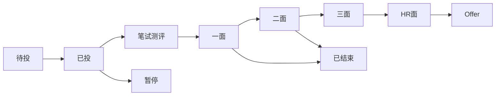

# 岗位管道

> 一行一个「公司 × 岗位」。阶段决定它落在看板哪一列，「下一轮时间」决定它是否出现在首页的近期面试里。

## 管道

| 公司 | 岗位 | 阶段 | 投递日期 | 下一轮时间 | 下一步 | 准备度 | 关联成果 | 关联知识 |
|------|------|------|----------|------------|--------|--------|----------|----------|
| 示例公司A | 平台架构师 | 一面 | 2026-10-20 | 10-29 14:00 | 把千万级 App 的 QPS 优化讲成 3 分钟版本 | 低 | EX-900 | K-900 |
| 示例公司B | AI 应用负责人 | 已投 | 2026-10-26 | | 补一份 RAG 落地效果的数字 | 中 | EX-900 | K-900 |
| 示例公司C | 技术专家 | 待投 | | | 先确认 JD 里的多团队规模要求 | 高 | EX-900 | |

## 列约定

| 列 | 怎么填 |
|------|------|
| 阶段 | 只能取：待投 / 已投 / 笔试测评 / 一面 / 二面 / 三面 / HR面 / Offer / 暂停 / 已结束 |
| 投递日期 | `YYYY-MM-DD`，用来算「投了几天没回音」 |
| 下一轮时间 | `MM-DD HH:mm` 或 `YYYY-MM-DD`；没安排就留空。**留空的行不会进首页的近期面试。** |
| 下一步 | 一句可执行的话，不要写「准备面试」这种没法检查的 |
| 准备度 | 高 / 中 / 低 —— 低就是「现在进去会被问倒」 |
| 关联成果 | 写 `EX-001` 这样的编号，视图靠它把经历挂到岗位上 |
| 关联知识 | 写 `K-004` 这样的编号，训练室会把它们作为追问素材 |

## 阶段怎么流转

**「已结束」不是失败记录，是数据。** 每一轮挂了要把「被问倒的那道题」抄进公司作战室，否则同一家公司下次还会用同一道题问倒你。
