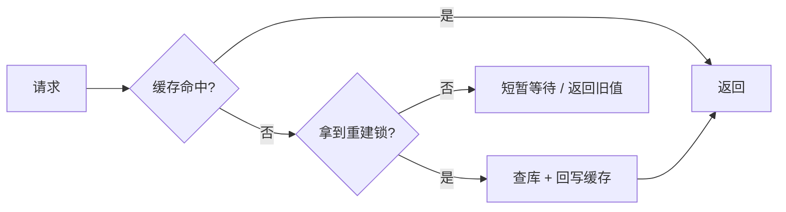

# 缓存击穿与穿透

> 一句话本质：热点 key 失效的那一瞬间，所有请求都砸到数据库上；穿透则是压根不存在的 key 每次都砸库。这是一张示例卡（K-900），整篇可直接替换成你自己的知识。

## 为什么需要它

缓存解决的是「重复读太贵」，但它把两种极端情况留给了你：一个 key 恰好过期、以及一个 key 根本不存在。这两种情况下的失败模式都是数据库被打穿，而不是缓存变慢。

## 关键 trade-off

| 方案 | 优势 | 代价 | 什么时候选它 |
|------|------|------|-------------|
| 互斥锁重建 | 实现简单，只有一个请求回源 | 其余请求要等或返回旧值 | 热点 key、允许轻微不一致 |
| 逻辑过期 | 不阻塞读，延迟平稳 | 要维护额外字段，返回的可能是旧数据 | 高并发读、对新鲜度不敏感 |
| 空值缓存 | 直接挡住穿透 | 大量不存在的 key 会把缓存占满 | 恶意/异常 key 占比可控 |
| 布隆过滤器 | 内存省，挡住绝大多数穿透 | 有误判率，删除要额外设计 | key 空间已知且量大 |

## 必须记住的数字

- 示例项目B 签到活动：单实例 QPS 由 2000 提到 4500，回源限流阈值设在日常的 1.2 倍
- 空值 TTL 压到 60 秒以内，否则失效 key 堆积会把内存吃到 80% 以上
- 逻辑过期方案下，最坏返回 30 秒前的旧值

## 图

## 面试追问链

1. 问：你怎么发现击穿的？ 答：监控回源 QPS 突刺 → 追问：阈值怎么定的，误报多少
2. 问：逻辑过期会不会返回脏数据？ 答：会，最坏 30 秒 → 追问：业务上什么场景不能忍这个
3. 问：布隆过滤器误判怎么办？ 答：放行到数据库 → 追问：误判率 1% 在你的量级下是多少请求

## 我的项目锚点

- `EX-900`：签到活动高峰期的 Redis + 互斥锁重建方案，就是这张卡的实现现场

## 复习记录

| 日期 | 结果 |
|------|------|
| 2026-09-20 | 顺，第 3 层追问卡在想误判率算法 |
