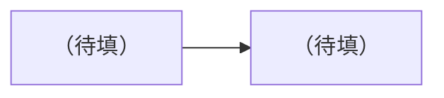

# K-000 知识点名称（复制本文件后改名 K-001-知识点名.md）

> 一句话本质：（待填）不用术语解释它是什么。如果一句话说不清，说明你还没吃透。

## 为什么需要它

（待填）它解决了什么前身方案解决不了的问题。理解「为什么被发明」比记住「它是什么」牢得多。

## 关键 trade-off

（待填）这张表是整张卡最重要的部分。面试考的就是取舍。

| 方案 | 优势 | 代价 | 什么时候选它 |
|------|------|------|-------------|
| （待填） | | | |

## 必须记住的数字

（待填）说得出数字，别人才信你真的用过。

- 默认值 / 阈值 / 量级：（例）单分区写入上限、默认超时、典型 QPS 量级
- 对比数字：（例）两种方案的延迟差几倍

## 图

（待填）画**关系**不画定义。看它在你系统里的位置。

## 面试追问链

（待填）按「他问 A → 你答 B → 他顺着 B 问 C」的链条写。写不出第二层，说明准备只到表面。

1. 问：…… 答：…… → 追问：……

## 我的项目锚点

（待填）把知识和自己的经历焊在一起。**面试里能说出「我在 XX 项目里用过」比背定义强十倍。**

- `EX-`（成果卡编号）：具体是在哪个环节用到的

## 复习记录

| 日期 | 结果 |
|------|------|
| （待填） | 顺 / 卡在第几层追问 |
