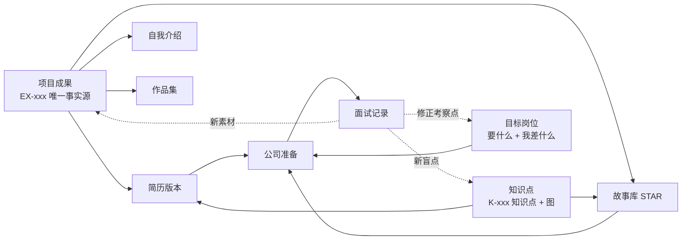

# 这套系统怎么运转

> 一句话：项目成果是唯一事实源，其它板块都是它的派生视图或它的输入。

## 派生关系



读法：**左边积累，中间组装，右边实战，实战的产出再回流到左边。** 闭环一旦转起来，每面一次，整库都会变强。

## 两个板块为什么不走文档渲染

`项目成果` 和 `知识点` 是**卡片墙**，不是文章。它们需要：

- 每张卡独立成块（而不是一篇长文）
- 卡片上直接出图
- 能算统计量（缺图的有哪些、该复习的有哪些、覆盖度如何）

所以它们有专用视图。其余板块都是 md 文章，走通用渲染器 —— **加一个目录就等于加一个板块，不用改代码。**

## 三层结构

| 层 | 板块 | 使用节奏 |
|----|------|---------|
| 长期积累 | 总览 / 职业定位 / 项目成果 / 知识点 | 长期，持续积累 |
| 求职 | 目标岗位 / 面试问答 / 公司准备 / 面试记录 | 冲刺期，按项目走 |
| 系统 | 使用说明 / 决策日志 | 偶尔回来看 |

## 三条铁律

1. **成果只写一次。** 简历、故事、作品集里出现的内容，都必须能在项目成果找到出处。发现哪份稿子里的表述在库里没有 → 补卡，而不是就地在稿子里改。
2. **没有数字的成果不算成果。** 翻不到数据就标注「待补数据，来源：XX」，别用形容词糊过去。
3. **每个项目、每个知识点都要有图。** 图不是装饰 —— 它是「你能不能在白板上画出来」的检验，也是回忆时的第二条通路。

## 工作台怎么跑

```bash
npm install
npm run dev        # 端口 5175
```

数据是自动生成的：`npm run gen:data` 扫描 `content/` 下的 md → `src/data/generated.json` → 界面。
`predev` / `prebuild` 钩子会自动跑，不用手动记。

**所以：改内容是改 md，不是改代码。**
