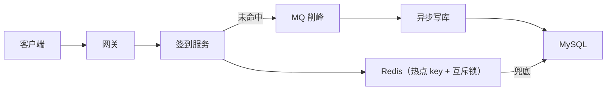

# 示例项目B 签到活动高并发改造

> 把单实例 QPS 从 2000 提到 4500，靠的不是加机器，是三层同时收口。这是一张示例卡（EX-900），数字与项目都是虚构的，整篇可替换。

## 影响

| 指标 | 改造前 | 改造后 | 我的动作 |
|------|--------|--------|----------|
| 单实例 QPS | 2000 | 4500 | 签到热点 key 改互斥锁重建 + 逻辑过期兜底 |
| 高峰 P99 延迟 | 820ms | 210ms | MQ 削峰，写请求异步落库 |
| 数据库峰值连接 | 打满 | 稳定在 60% | 回源限流阈值按日常 1.2 倍收口 |
| 事故次数 | 2 次/季度 | 0 | 加了缓存命中率与回源 QPS 两条告警 |

## 架构图

## 关键决策

- 为什么用互斥锁而不是全量逻辑过期：签到排行榜对新鲜度敏感，接受不了 30 秒旧值。
- 为什么不直接扩容：瓶颈在回源数据库连接数，加机器只会把数据库打得更快。
- 为什么把写改成异步：签到允许 2 秒内看到自己成功，但绝不允许整场活动挂掉。

## 难点与踩坑

- 上线第一天命中率反而下降：预热脚本没覆盖到跨天 key，第二天补了双 key 过渡。
- MQ 异步写带来的重复签到：加了幂等号，按 用户+活动+日期 唯一。

## 复盘

数字是真的，但讲的时候最容易翻车的是「为什么不用另一种方案」——那部分要单独练。
